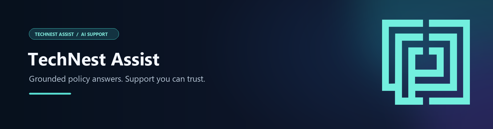
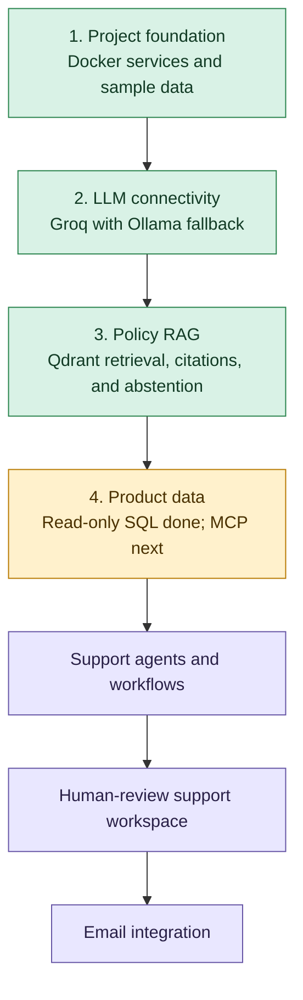
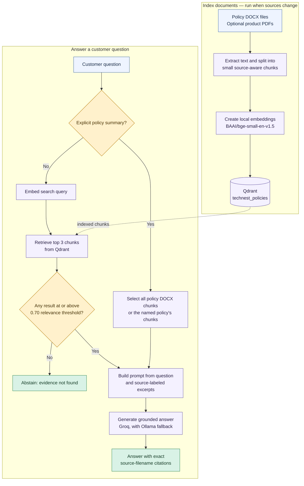

[](https://www.python.org/)
[](https://www.postgresql.org/)
[](https://qdrant.tech/)
[](https://groq.com/)
[](https://ollama.com/)
[](https://www.docker.com/)

TechNest Assist is a prototype AI assistant for a fictional technology retailer. The
repository contains a repeatable sample-data generator, policy-grounded retrieval,
read-only product lookups, and a small Groq/Ollama LLM connectivity example.

> **Project status:** Policy-grounded retrieval (RAG) and read-only product
> lookups are implemented as command-line/code milestones. Agent workflows,
> human review, and email integration remain in development; the standalone LLM
> example remains a smoke test.

## Current capabilities

- Start PostgreSQL, Qdrant, and Mailpit locally with Docker Compose.
- Generate sample product records, product datasheets, policy documents,
  certificates, and tender documents.
- Look up products in PostgreSQL by product code, name, or category using
  read-only, parameterized queries.
- Call a Groq chat model when configured, with Ollama as a fallback.
- Index Word policy documents and optionally product PDFs in Qdrant; answer
  questions with source citations and abstain when relevant evidence is
  unavailable. Broad policy summaries exclude product datasheets.
- Run automated tests and a named RAG evaluation suite for retrieval, citations,
  abstention, and known answer-grounding traps.

## Milestone roadmap



The first three milestones and the read-only SQL product lookup are implemented.
MCP exposure is the next product-data step; agent workflows, the review UI, and
email integration remain future work.

## How policy RAG works

The diagram shows the offline indexing path and what happens for each question.
Factual questions use relevance-filtered retrieval; explicit policy summaries
select policy chunks directly. Product PDFs can answer factual product questions
when indexed, but are left out of broad policy summaries.




## Technology

- Python
- PostgreSQL
- Qdrant
- Groq API and Ollama
- Docker Compose

## Prerequisites

- Python 3.12
- Docker Desktop with Docker Compose
- Ollama, if you want to use the local model or Groq fallback
- A Groq API key, if you want to use Groq (optional)

The full `requirements.txt` includes machine-learning packages such as PyTorch
and sentence-transformers, so the initial installation may take some time and
disk space.

## Setup

In PowerShell, from the repository root:

```powershell
py -3.12 -m venv .venv
.\.venv\Scripts\python.exe -m pip install --upgrade pip
.\.venv\Scripts\python.exe -m pip install -r requirements.txt
```

Start the local services:

```powershell
docker compose up -d
```

The services are available at:

| Service | Address |
| --- | --- |
| PostgreSQL | `localhost:5432` |
| Qdrant HTTP API | `http://localhost:6333` |
| Qdrant gRPC | `localhost:6334` |
| Mailpit web UI | `http://localhost:8025` |
| Mailpit SMTP | `localhost:1025` |

## Generate sample data

```powershell
.\.venv\Scripts\python.exe .\seed_data.py
```

The script generates 200 sample products, product datasheets, three policy
documents, certificates, and three tender documents with 15–20 requirements
each. It also writes expected tender answers to
`data/tender_answer_key.xlsx` and upserts product records in PostgreSQL.

The seed script uses the PostgreSQL settings below by default. Override them
with environment variables if your local database uses different values:

| Variable | Default |
| --- | --- |
| `PGHOST` | `localhost` |
| `PGPORT` | `5432` |
| `PGDATABASE` | `technest_db` |
| `PGUSER` | `technest_user` |
| `PGPASSWORD` | `technest_password` |

## Product data lookup

`product_queries.py` provides read-only lookup functions for the seeded
PostgreSQL `products` table: `get_product_by_code()` for exact catalog codes and
`search_products()` for name-substring and/or category filters. Results have a
stable `ProductRecord` shape containing product code, name, category, price,
and stock quantity. No match returns `None` for a code lookup or an empty tuple
for a search; invalid input raises `ValueError`, while database errors surface
to the caller. The functions use parameterized SQL, read-only transactions, and
the same `PG*` connection settings listed above.

## MCP server

Run `mcp_server.py` through a stdio MCP client. The server exposes only
read-only tools:

- `get_product_by_code`: exact catalog-code lookup
- `search_products`: bounded name/category search
- `search_documents`: existing policy/PDF retrieval with source metadata

The product tools delegate to `product_queries.py`; document retrieval delegates
to `PolicyRAG.search()` and does not run a chat model or expose mutations. Run
focused in-process tests with:

```powershell
.\.venv\Scripts\python.exe -m pytest tests/test_mcp_server.py -q
```

## Run the LLM example

### Groq

Set your GROQ API key in the current PowerShell session, then run the example:

```powershell
$env:GROQ_API_KEY = "your-groq-api-key"
.\.venv\Scripts\python.exe .\first_llm_call.py
```

The default Groq model is `openai/gpt-oss-120b`. To select another model, set
`GROQ_MODEL` before running the script.

### Ollama

Install Ollama, download the default model, and run the example:

```powershell
ollama pull llama3.2:1b
.\.venv\Scripts\python.exe .\first_llm_call.py
```

When `GROQ_API_KEY` is not set, the script uses Ollama directly. If a Groq
request fails, it reports the error and tries Ollama. The default local model
is `llama3.2:1b`; set `OLLAMA_MODEL` to use another model already installed in
Ollama.

## Policy RAG

The policy RAG flow embeds the Word files in `data/policies/` locally with
`BAAI/bge-small-en-v1.5` and stores source-aware chunks in the
`technest_policies` Qdrant collection. If you also want generated product
specs and datasheets in `data/pdfs/` included, use the optional
`--include-pdfs` flag. The first run downloads the embedding model if it is
not already cached. Re-running the index command updates changed documents
without accumulating duplicate or stale chunks:

```powershell
docker compose up -d qdrant
.\.venv\Scripts\python.exe .\policy_rag.py index
.\.venv\Scripts\python.exe .\policy_rag.py index --include-pdfs
```

Ask questions using Groq when `GROQ_API_KEY` is set, with Ollama as fallback;
otherwise Ollama is used directly. Ollama must be running with the configured
`OLLAMA_MODEL` installed. Factual questions use the top three policy matches
that meet the relevance threshold and abstain if none do. Explicit policy
summary requests instead use all indexed policy chunks, or only the chunks for
a named policy, and ask for a source-cited overview. A summary request for a
policy that is not indexed abstains.
For policy summaries, tone requests can change the presentation while factual
claims should remain supported by the indexed excerpts and cite their sources.

```powershell
ollama pull llama3.2:1b
.\.venv\Scripts\python.exe .\policy_rag.py ask "What is the hardware warranty?"
.\.venv\Scripts\python.exe .\policy_rag.py ask "Summarize the main policies in the documents."
```

Configuration overrides: `POLICY_EMBEDDING_MODEL`, `QDRANT_URL`, and
`POLICY_COLLECTION`.

## Run tests and RAG evaluation

```powershell
.\.venv\Scripts\python.exe -m pytest

# Policy-only live evaluation against local Qdrant and Ollama/Groq
.\.venv\Scripts\python.exe rag_evaluation.py

# Include all generated PDF datasheets
.\.venv\Scripts\python.exe rag_evaluation.py --include-pdfs
```

The evaluation reports retrieval recall, citation recall, abstention accuracy,
and answer grounding. Passing retrieval and citation checks does not by itself
prove every sentence is supported; the case suite includes forbidden-answer
terms for known grounding traps such as mixing unopened and defective return
periods.

## Repository layout

```text
.
├── data/                 # Generated sample documents and spreadsheets
├── tests/                # Automated tests
├── docker-compose.yml    # Local PostgreSQL, Qdrant, and Mailpit services
├── first_llm_call.py     # Groq/Ollama connectivity example
├── policy_rag.py         # Policy indexing and retrieval-augmented answers
├── product_queries.py    # Read-only PostgreSQL product lookups
├── requirements.txt      # Python dependencies
└── seed_data.py          # Sample data and database seeding
```

## Important notes

- The credentials in `docker-compose.yml` are for local development only. Do
  not use them in a production deployment.
- The seed script updates generated products in the `TN-LAP-*`, `TN-MON-*`,
  and `TN-OFF-*` sample-code namespaces. It does not drop the products table.
- Generated data and local database contents are for development and testing;
  they are not production catalog or policy data.
